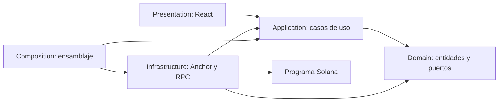

# Arquitectura de KhipuTrace

## Verificación de aceptación — 4.2

Sin cambios de negocio ni de dependencias entre capas. El comprobador Devnet usa createAppServices/createRepositories para los flujos válidos. Los rechazos críticos construyen instrucciones Anchor firmadas directamente, para alcanzar Rust con entradas que el cliente normalmente valida antes; no se relajan controles productivos. Los snapshots usan AccountReader/mappers para ownership, PDA, bump y estados, junto con bytes originales y comparación exacta.

La UI automatizada ejecuta el build de producción y RPC real. Un proveedor Wallet Standard exclusivo de la prueba delega firma en Wallet.local oficial Node con archivo externo; solo acepta instrucciones/PDAs de la auditoría prevista y limita firmas. No se incorpora un firmante de servidor, endpoint o clave al producto. Cliente/presentación no cambiaron; revisión manual con extensión queda pendiente. Los runners requieren ejecución explícita, preservan reportes y permiten reconciliar una firma confirmada sin repetir la escritura. Evidencias y reproducción en TEST_EVIDENCE.md y README.

## Despliegue Devnet verificado — 4.1

Sin cambios de capas, cuentas, instrucciones o reglas. Identidad real `GV8SZn6i29tL4CmJMei5P3N3BLUxVZBWrG6hFQVSVSBv`, con keypair fuera del proyecto, desplegada con autorización y verificada contra el ELF aprobado. Rust, programas Localnet/Devnet de Anchor.toml, IDL generado/tipos, configuración y build frontend concuerdan. El cliente comprobó genesis y ejecutabilidad antes de una CreateAudit real; CreateAudit/GetAudit y repositorios existentes confirmaron/releyeron sus datos. La wallet oficial Node de Anchor solo se usa en el procedimiento operativo de scripts/devnet-smoke; no cambia las wallets ni capas del frontend.

El IDL se obtiene mediante el builder oficial existente. Solana CLI/keygen 2.3.0 provienen de la caché verificada; Anchor CLI no es requerida por este procedimiento. El primer envío RPC fue rechazado tras agotar reintentos; la reanudación QUIC reutilizó buffer/identidades/artefacto. Se verificó la combinación CLI/ELF/cluster ejecutada; el hash de código descargado y leído de ProgramData es idéntico al ELF local. Detalles: [DEPLOYMENT.md](DEPLOYMENT.md). Sin despliegue del frontend ni IDL on-chain; recorrido completo con extensión pendiente.

Las cuentas históricas de 1.3 conservan su Program ID/owner/PDAs originales. Su prueba de decodificación toma la identidad del reporte y aplica el esquema actual compatible; no reescribe evidencia ni relaja validaciones productivas para admitir un ID antiguo. El estado siguiente se conserva como histórico por submódulo.

## Estado y decisiones

Actualizado en 2.2, 22 de noviembre de 2026. Están implementadas las cuentas Anchor, las cinco instrucciones y utilidades de lectura validada. Compilación SBF v0 y 17 pruebas transaccionales locales en LiteSVM aprobadas en 1.3. Hay IDL generado y repositorios TypeScript tipados de 2.1. En 2.2 se implementaron los siete casos de uso Application y su composición, sin pantallas ni despliegue/ejecución Devnet.

La fuente de verdad del negocio será el programa Solana. El frontend consulta cuentas y prepara solicitudes firmadas por la wallet responsable. Se usa RPC público de Devnet o un validador Localnet, sin backend, base de datos, indexador, almacenamiento de documentos ni servicios adicionales. Los datos on-chain son públicos y deben ser sintéticos.



Las flechas entre capas indican dependencias de código. Application usará interfaces inyectadas; no importará implementaciones. El acceso RPC quedará en Infrastructure. Composition ensambla servicios y el arranque los entrega a Presentation. Domain solo usa tipos del lenguaje, con IDs y contadores `bigint`; no expone `PublicKey`, `BN`, `Connection`, `Program` ni hooks.

## Estructura preparada

```text
programs/khiputrace/src/
  lib.rs                 entry points de las cinco instrucciones
  domain/                enums y límites independientes de Anchor
  state/                 cuentas Anchor, seeds y lectura validada
  instructions/          contextos y handlers por operación
  errors.rs              errores Anchor y mapping desde errores puros
programs/khiputrace/tests/layout.rs
frontend/src/
  domain/                entidades e interfaces de lectura/escritura
  application/           contratos de casos de uso y dependencias
  infrastructure/anchor/ contrato del contexto del adaptador
  presentation/          pantalla de estado del scaffold
  composition/           contrato de servicios para el ensamblaje
  main.tsx               arranque React
scripts/                 verificadores sin despliegue ni instalaciones
tests/scaffold/          pruebas de límites arquitectónicos
config/toolchain.json    matriz elegida
```

Los modelos usan `#[account]` e `InitSpace`; el crate produce `cdylib` y `lib`. Los entry points delegan en módulos de creación separados. `domain/rules.rs` contiene validación de texto y cálculo de contadores sin Anchor; `errors.rs` traduce esos errores a Anchor. Los esquemas y enums serializados residen en state. Update, resolve y close tienen contextos propios para declarar únicamente las cuentas mutables necesarias. Las declaraciones explícitas de seguridad se repiten en los contextos; las reglas reutilizables de texto, estado y aritmética permanecen en Domain.

Anchor requiere una identidad para `Owner`, PDAs y dispatch: `declare_id!` y `[programs.localnet]` comparten la identidad pública provisional `3ntLzGokkxHGrNX5BDskidyew4Cn3RqL29ECUDo2ZCy1`. Es el base58 de SHA-256 de `KhipuTrace:local-development:program:v1`; no se generó una clave privada ni corresponde a un despliegue. Su finalidad es compilar y probar de forma reproducible, sin aparentar disponibilidad en una red. Antes de desplegar se debe reemplazar y sincronizar con una clave pública real autorizada y regenerar IDL/cliente/evidencias. No hay tabla Devnet ni script de deploy.

## Modelo de cuentas

`Audit` es la raíz del agregado: autoriza las mutaciones de sus hallazgos y conserva su secuencia. `Finding` guarda una referencia a la dirección de Audit. No se duplicará la autoridad en Finding. La autoridad es inmutable en el MVP y no se implementa cierre de auditorías.

| Campo de Audit | Tipo on-chain | Regla |
| --- | --- | --- |
| version | u8 | Versión inicial 1. |
| authority | Pubkey | Wallet responsable, firmante y pagadora al crear. |
| audit_id | u64 | Elegido por el cliente dentro de su autoridad; inmutable. |
| title | String | Texto normalizado, 1–96 bytes UTF-8. |
| next_finding_id | u64 | Comienza en 0; solo aumenta al crear hallazgos. |
| active_findings | u64 | Número de cuentas Finding existentes, abiertas o resueltas. |
| open_findings | u64 | Número de hallazgos abiertos existentes. |
| bump | u8 | Bump canónico obtenido al inicializar. |

| Campo de Finding | Tipo on-chain | Regla |
| --- | --- | --- |
| version | u8 | Versión inicial 1. |
| audit | Pubkey | Referencia inmutable a Audit. |
| finding_id | u64 | Valor de next_finding_id al crearse. |
| severity | enum de un byte | Low, Medium, High, Critical, en ese orden. |
| status | enum de un byte | Open=0, Resolved=1. |
| title | String | 1–96 bytes UTF-8. |
| description | String | 1–512 bytes UTF-8. |
| remediation_note | String | Vacía en Open; mínimo 10 caracteres Unicode y máximo 512 bytes UTF-8 en Resolved. |
| bump | u8 | Bump canónico. |

Normalización implementada en creación para título y descripción: aplicar `str::trim()` antes de validar y persistir cada campo textual. Por instrucción del usuario en 1.2, una acción correctiva válida tiene al menos 10 valores escalares Unicode tras trim, contados con str::chars().count(), y como máximo 512 bytes UTF-8. Esta regla sustituye el mínimo de 12 bytes propuesto en 0.2; no cuenta bytes ni unidades UTF-16 como caracteres, ni añade una dependencia para contar grafemas. No certifica calidad semántica. Se valida en Rust antes de resolver y se vuelve a comprobar antes de cerrar. La creación fuerza Open y nota vacía. Los máximos de almacenamiento siguen siendo bytes. Los DTO del frontend son datos aún no validados; los adaptadores deberán comprobarlos, incluida representación de u64 entre 0 y `u64::MAX`.

Se reserva el discriminator Anchor estándar de 8 bytes. Espacio máximo calculado: Audit = **174 bytes**; Finding = **1184 bytes**, incluyendo prefijos Borsh de 4 bytes por String y un byte por enum. `InitSpace` dimensiona; no valida las longitudes en ejecución. La prueba host serializa cadenas multibyte máximas y verifica el layout. Audit::SPACE y Finding::SPACE incluyen el discriminator real del tipo. Hay pruebas de serialización completa con discriminator, aparte de las de payload Borsh.

## PDAs y pertenencia

Derivar bajo la identidad declarada de KhipuTrace, actualmente provisional para desarrollo:

| Cuenta | Seeds, en orden |
| --- | --- |
| Audit | `b"audit"`, `authority.as_ref()`, `audit_id.to_le_bytes()` |
| Finding | `b"finding"`, `audit.key().as_ref()`, `finding_id.to_le_bytes()` |

Los IDs usan 8 bytes little-endian, nunca texto decimal. Todos los seeds individuales respetan el límite de 32 bytes. Las etiquetas son distintas y tienen tamaño fijo. La dirección final es independiente del contenido mutable.

Crear Audit con `init` y bump canónico. Como Audit no se cierra, repetir `(authority, id)` no permite reinicializarla. El cliente puede elegir otro ID libre tras una colisión; no se necesita una cuenta global de registro.

Crear Finding exige `expected_next_id == audit.next_finding_id`; esa cifra, no un ID libre arbitrario, determina sus seeds. Tras un cierre, `next_finding_id` conserva su valor. No usar `init_if_needed`. En modificaciones verificar owner/discriminator, PDA, bump almacenado previamente canónico, `finding.audit == audit.key()` y `audit.authority == signer.key()`. Las instrucciones obtienen el bump de ctx.bumps, nunca de un argumento de cliente. CreateFinding recalcula la PDA canónica de Audit y contrasta el bump almacenado; Account<Audit> comprueba owner y discriminator y has_one comprueba la autoridad. Los constructores nativos build_audit/build_finding preparan datos sin persistirlos: sus parámetros no sustituyen las restricciones de cuentas de los handlers.

## Operaciones e invariantes

| Operación | Contrato (estado de implementación indicado) |
| --- | --- |
| create_audit (implementada) | Authority firma y paga. Título válido. PDA nueva. Contadores y next ID a cero. |
| Leer Audit (implementada en Rust) | Deserialización pública con validación de owner, discriminator, versión, PDA, bump y contadores. Consultas RPC/listados pendientes en el adaptador. Sin instrucción de lectura on-chain. |
| create_finding (implementada) | Authority firma y paga; Audit mutable. Crea Open con acción vacía; incrementa next ID, active_findings y open_findings. |
| Leer Finding (implementada en Rust) | Valida también la auditoría, relación, ID emitido, PDA y bump. Consultas RPC/listados pendientes. Sin instrucción de lectura on-chain. |
| update_finding (implementada) | Authority firma; relación correcta; solo Open. Reemplaza título, descripción y severidad validados; no modifica identidad, acción ni contadores. |
| resolve_finding (implementada) | Authority firma; relación correcta; solo Open. Persiste acción válida, pasa a Resolved y decrementa open_findings. |
| close_finding (implementada) | Authority firma; relación correcta; solo Resolved. Cierra Finding devolviendo renta a authority y decrementa active_findings. No altera next ID ni open_findings. |

En todo estado válido: `0 <= open_findings <= active_findings <= next_finding_id`. Los resueltos existentes se calculan como `active_findings - open_findings`; no almacenar un tercer contador redundante. Todos los incrementos/decrementos usan `checked_add`/`checked_sub` y fallan atómicamente. Si next ID llega a `u64::MAX`, no se crean nuevos hallazgos: no puede avanzarse la secuencia, por lo que el último ID emitible es `u64::MAX - 1`.

No se permite reabrir, modificar resueltos, resolver dos veces, cerrar abiertos ni transferir autoridad. Closed representa ausencia de cuenta, no un tercer estado serializado. Crear y resolver requieren Audit mutable para serializar cambios concurrentes. Una solicitud con next ID obsoleto falla y el cliente debe refrescar; no reintentar firmas silenciosamente. No añadir listas de Pubkeys de hallazgos a Audit: consultar por relación evita crecimiento y realloc.

Los contextos declaran únicamente las cuentas mutables necesarias: create_audit (authority y Audit), create_finding (authority, Audit y Finding), update_finding (Finding), resolve_finding (Audit y Finding), close_finding (Audit, Finding y authority receptora). Authority siempre será Signer; el System Program solo participa cuando se inicializa una cuenta. El Audit de update se lee para autorización y pertenencia.

Los nombres de campos se ajustaron a la propuesta de 1.1: id pasa a audit_id/finding_id; finding_count/open_finding_count pasan a active_findings/open_findings y corrective_action a remediation_note. Se mantienen version y description del diseño previo. No existe estado desplegado que migrar; el tamaño no cambia. Los tipos del frontend permanecen estables: el futuro adaptador mapeará audit_id/finding_id a id, active_findings a findingCount, open_findings a openFindingCount y remediation_note a correctiveAction. No se implementa ese adaptador en 1.1.

## Contratos entre capas

- `domain/entities.ts`: vistas inmutables; Finding es una unión discriminada que separa Open sin acción de Resolved con acción.
- `domain/ports.ts`: interfaces pequeñas `AuditReader`, `AuditWriter`, `FindingReader`, `FindingWriter`, entradas específicas y `MutationReceipt`. La autoridad viene de la wallet firmante del adaptador, no de un campo modificable del formulario.
- `application/contracts.ts`: `UseCase<Input, Output>` y contratos de escritura; las lecturas inicialmente usan los puertos de consulta, sin casos de uso vacíos que solo reenvíen llamadas.
- `infrastructure/anchor/contracts.ts`: contexto de `AnchorProvider` y `Program<Idl>` reservado para implementar repositorios. Se sustituirá el IDL genérico por el tipo generado real cuando exista; no fabricar un IDL vacío.
- `composition/contracts.ts`: servicios que recibirá la presentación; sin instancias globales de conexión.

El adaptador futuro hará mapping `BN/u64 <-> bigint`, Pubkey a dirección, enums Anchor a uniones de dominio y acción vacía a `null` para Open. Rechazará cuentas inesperadas, versiones de schema desconocidas y datos inválidos. Lecturas inexistentes devuelven `null`; errores RPC nunca se disfrazan de listas vacías. Los fallos se mapearán a errores comprensibles manteniendo la causa técnica para diagnóstico. `MutationReceipt.reference` será la firma confirmada, independiente del SDK. Guardar blockhash y lastValidBlockHeight para confirmar y luego refrescar las cuentas; no mostrar éxito antes de la confirmación.

## Versiones y justificación

| Elemento | Selección | Fundamento y estado |
| --- | --- | --- |
| Rust host | Instalado 1.99.1; mínimo 1.89 | Anchor 0.32 requiere >=1.89 para generar IDL. No se cambia toolchain global. |
| Anchor CLI / anchor-lang / cliente TS | 0.32.2 | Patch documentado de la línea 0.32, con cliente renombrado a `@anchor-lang/core` y soporte de transacciones v1. |
| Agave/Solana CLI | 2.3.0 | Recomendación explícita de Anchor 0.32.2; CLI aún no instalada. |
| platform-tools / arquitectura SBF | v1.52 / v0 | Rust 1.89 en tools v1.52; override explícito del default v1.48 de Agave 2.3.0, cuyo Rust 1.84.1 es insuficiente para el MSRV del crate y dependencias actuales. Build SBF ejecutado en 1.3. |
| Node / npm | 24.22.0 / 11.19.1 | Conservar herramientas existentes; `.nvmrc` y packageManager documentan la selección. |
| web3.js | 1.99.0 | Dependencia exacta del cliente Anchor 0.32.2. No mezclar con API de web3 v2. |
| React / React DOM | 19.3.1 | Versiones iguales y peer compatible. |
| Vite / plugin React | 8.3.5 / 6.2.1 | Plugin exige Vite 8; ambos aceptan el Node instalado. |
| TypeScript | 5.9.3 | Compilador estricto sin migración a TS 7; validar las declaraciones con skipLibCheck=false. |
| Tipos Node / React / React DOM | 24.12.2 / 19.3.0 / 19.3.0 | Familias correspondientes al runtime y React seleccionados. |
| Tipos BN | 5.2.0 | Necesarios para comprobar las declaraciones del cliente Anchor sin ocultar errores de librerías. |

Las versiones npm se contrastaron con metadatos del registro y sus engines/peers. Las dependencias directas son exactas y los lockfiles fijan el grafo resuelto. No se incorporan wallet adapters hasta la integración de wallet; no hay tokens/SPL ni necesidad de anchor-spl, Codama, Docker, Yarn, pnpm o un framework de tests adicional.

Cargo permite patches compatibles en dependencias internas de Anchor: el lockfile resuelve varios macros de Anchor a 0.32.3 aunque `anchor-lang` directo es 0.32.2. Esa resolución queda fijada y se verifica en host; no se afirma que todos los paquetes transitivos lleven el mismo patch. La instalación reproducible npm se comprobó con `--ignore-scripts`; las extensiones nativas opcionales de WebSocket no son necesarias para este scaffold y no se autorizó su ejecución automática.

Compatibilidad declarada y compatibilidad ejecutada son distintas: los resultados efectivos y cualquier vulnerabilidad reportada por npm se registran en PROGRESS y TEST_EVIDENCE. La combinación Anchor/Agave/platform-tools se verificó mediante build SBF y LiteSVM en 1.3; IDL generado en 2.1; ejecución mediante RPC/validador sigue pendiente. La documentación actual de Anchor 1.x describe otro toolchain: no aplicar sus defaults de SBF v3 a esta línea 0.32.

Al habilitar el programa real, usar explícitamente `anchor build -- --tools-version v1.52 --arch v0` y verificar la salida efectiva de build-sbf. Este comando no se ejecuta en 0.2: puede descargar y registrar herramientas SBF en el entorno del usuario, además de requerir un programa habilitado. La selección de tools se fundamenta en [platform-tools v1.48, Rust 1.84.1](https://github.com/anza-xyz/platform-tools/releases/tag/v1.48) y [v1.52, Rust 1.89.0](https://github.com/anza-xyz/platform-tools/releases/tag/v1.52). No basta instalar la CLI 2.3.0 y asumir que su compilador predeterminado cubre el lockfile actual.

Fuentes consultadas el 21 de noviembre de 2026: [Anchor 0.32.2](https://www.anchor-lang.com/docs/updates/release-notes/0-32-2), [requisito Rust de 0.32](https://www.anchor-lang.com/docs/updates/release-notes/0-32-0), [SDK Agave 2.3.0](https://github.com/anza-xyz/agave/blob/v2.3.0/platform-tools-sdk/sbf/scripts/install.sh), [Vite](https://vite.dev/guide/), [manifest de referencia WayLearn](https://github.com/WayLearnLatam/Registro-Ventas-Solana-App/blob/main/package.json). Se consultaron también metadatos de las versiones npm y `anchor-lang 0.32.2` en crates.io. Se toma el material como referencia, sin copiar una implementación de negocio.

## Verificación y recursos

`npm run verify` ejecuta comprobación de capas, tests del verificador, TypeScript, bundle y Rust host (fmt/check/test, dos jobs, lockfile obligatorio). `npm run check:toolchain` comprueba CLI de Anchor, Solana, build-sbf y validador, falla si faltan o no coinciden. `npm run check:dependencies` ejecuta npm audit y falla con avisos moderados o superiores. Estos últimos checks están separados para distinguir herramientas ausentes y riesgos de dependencias del build del scaffold. No inicia procesos persistentes ni despliega. Las herramientas de cadena faltantes no se ocultan como pruebas aprobadas.

## Estado documental 5.2

La revisión final confirma la separación Domain/Application/Infrastructure/Presentation descrita arriba y no identifica cambios de arquitectura pendientes en el alcance. Clean Architecture sigue siendo verificable mediante `npm run verify` y el chequeo estático de imports. La matriz WayLearn y la guía de demo describen el estado real sin convertir la UI automatizada ni LiteSVM en una extensión real o consenso. Véanse [WAYLEARN_COMPLIANCE.md](WAYLEARN_COMPLIANCE.md) y [DEMO_GUIDE.md](DEMO_GUIDE.md).

El verificador de capas inspecciona imports, exports, imports dinámicos literales y tipos importados del frontend con el parser TS, además de `any` explícito. Las capas internas no aceptan dependencias externas; no hay aliases configurados. Es una ayuda estática, no una prueba formal ni una auditoría de seguridad. No aplica a dependencias transitivas npm ni sustituye revisión de código.

Usar compilaciones secuenciales y dos jobs de Cargo en este equipo. No se modifica Cargo global, swap ni el perfil del shell. El siguiente submódulo debe explicar cualquier instalación de CLI y sus efectos antes de ejecutarla.

## Verificación y límites de 1.2

La compilación host y los fixtures serializados no prueban ejecución de CPI, devolución real de renta, rollback transaccional ni aceptación en un validador. Se ejecutan los contextos generados de update/resolve/close con cuentas tipadas para probar autoridad ajena marcada como firmante, ausencia de firma, ownership, discriminator, relación, seeds, bump canónico, versión, estado y permisos de escritura. Se ejecuta además el entry point nativo de update/resolve y se comprueban los bytes persistidos y el estado conservado ante rechazos. La preparación de cierre se prueba sin ejecutar AccountsExit de cierre sobre memoria host, porque resize/assign requieren el layout del runtime Solana. Estos eran los límites al cerrar 1.2. En 1.3 se verificaron transferencia, destrucción, rechazo de reinicialización y rollback en LiteSVM; concurrencia de un validador sigue pendiente. La lectura Rust no solicita firmas ni envía transacciones; no implementa un repositorio RPC. Los resultados ejecutados se registran en TEST_EVIDENCE.md.

Referencias consultadas para las macros y restricciones: [estructura de programa Anchor](https://www.anchor-lang.com/docs/basics/program-structure) y [constraints de cuentas](https://www.anchor-lang.com/docs/references/account-constraints), contrastadas con el código local de anchor-lang 0.32.2.

El cierre usa `close = authority`, sin un destinatario libre. Antes de descontar active_findings se valida el estado, la nota, los contadores y checked_add del saldo receptor con los lamports de Finding: anchor-lang 0.32.2 usa checked_add(...).unwrap() internamente al cerrar, y esta precondición evita alcanzarlo con overflow. No hay CPI ni cambios de saldo entre esa comprobación y la salida del handler. next_finding_id y open_findings no se modifican al cerrar.

## Harness transaccional de 1.3

Las pruebas de integración están en `tests/sbf/test_program.py`. Usan unittest de Python y LiteSVM mediante solders 0.26.0: cargan el ELF SBF del programa, verifican firmas y blockhash y ejecutan sus instrucciones y CPI en memoria. No requieren servidor RPC, validador persistente, Anchor CLI, wallet en disco ni backend. La documentación oficial contempla [LiteSVM para probar programas Anchor](https://www.anchor-lang.com/docs/testing/litesvm). Esta ejecución local no acredita comportamiento de RPC, consenso, concurrencia del validador ni Devnet.

Los helpers codifican discriminators e instrucciones Borsh y decodifican las cuentas según el esquema Rust. No implementan reglas alternativas de negocio. Se comprueban owner, discriminator, espacio, campos y transiciones contra cuentas creadas por el programa. Los casos de overflow/underflow y bump/versión inválidos preparan estados límite mediante el acceso privilegiado del harness; no son estados obtenibles arbitrariamente por un usuario del programa.

Un pagador independiente cubre las comisiones para comparar sin cambios los saldos de autoridad y atacante tras un rechazo. Se comparan todas las cuentas de negocio observadas, incluidas PDAs que aún no existen. Cada rechazo debe contener el error exacto y logs de ejecución/fallo de KhipuTrace; no se acepta un error de transporte o firma de cliente como evidencia equivalente. Dos transacciones con varias instrucciones comprueban rollback tras resolver y tras cerrar/reembolsar.

`npm run setup:program-tests` verifica SHA-256 de archivos oficiales Agave 2.3.0/platform-tools 1.52 y de wheels Python fijados. Extrae solo herramientas necesarias en `.cache/sbf-tests`, ignorada por Git. Descargas de herramientas: aproximadamente 790 MB; caché extraída más archivos: aproximadamente 2.4 GiB. Requiere Linux x86_64, Python 3.12 y pip. No cambia PATH permanente, rustup ni configuración Solana. Usa los lockfiles existentes.

`npm run test:program` compila con `cargo-build-sbf --skip-tools-install --no-rustup-override --arch v0 --jobs 2 -- --locked`, usando el Rust 1.89.0-dev incluido en platform-tools 1.52 mediante variables del proceso. Un SDK mínimo local enlaza esas herramientas y usa llvm-objcopy para strip, evitando el instalador del strip.sh oficial que podría modificar rustup. Un archivo vacío temporal fuera del proyecto impide que build-sbf genere un keypair automáticamente; se elimina al terminar y solo se conserva el ELF en target/sbf. Las claves para firmar pruebas se generan exclusivamente en memoria. Los logs y el informe JSON se guardan en docs/evidence.

Resultado ejecutado en 1.3: 17 casos aprobados, 95 transacciones (50 aceptadas y 45 rechazadas por el programa). Todos los rechazos conservaron las cuentas observadas. Las firmas del informe son referencias del runtime local y no tienen enlace Explorer. El detalle y los límites están en [TEST_EVIDENCE.md](TEST_EVIDENCE.md).

## Infraestructura TypeScript — 2.1

Se conserva Domain sin React/Anchor/RPC y sus cuatro contratos pequeños AuditReader/AuditWriter/FindingReader/FindingWriter. `RepositoryError` es un error del límite de repositorio, independiente del SDK. `createRepositories` devuelve ApplicationDependencies; la presentación todavía no lo consume y los casos de uso no se implementan aquí.

| Archivo o grupo | Responsabilidad |
| --- | --- |
| infrastructure/anchor/generated | IDL original JSON producido por Anchor y versión camelCase con tipos literales y valor tipado. No editar a mano. |
| infrastructure/anchor/client.ts | Construye Program<Khiputrace>, lector y escritor; inyecta puertos y función que entrega la wallet conectada. |
| infrastructure/solana/config.ts y session.ts | Configuración explícita Localnet/Devnet, coherencia de Program ID/IDL, comprobación de genesis y cuenta ejecutable del programa. |
| infrastructure/solana/pdas.ts | Seeds compartidas con Rust: etiquetas fijas, claves públicas y u64 little-endian de 8 bytes. |
| infrastructure/anchor/accounts.ts y mappers.ts | Decodificación Anchor y validación de owner, discriminator, espacio, esquema, PDA/bump, pertenencia, enums, contadores y contenido antes del mapping. |
| infrastructure/anchor/repositories.ts | Consultas por dirección y listados filtrados, más construcción tipada de las cinco instrucciones con accountsStrict. |
| infrastructure/solana/transactions.ts | Firma por wallet externa, comprobación del mensaje, envío con preflight y confirmación por firma/blockhash/lastValidBlockHeight. |
| infrastructure/anchor/errors.ts | Convierte fallos de Anchor, wallet, RPC y confirmación a errores del contrato interno, conservando causa y referencia cuando existe. |

### Generación real de IDL

`npm run generate:idl` utiliza `tools/idl-generator`, una utilidad host pequeña que invoca **IdlBuilder de anchor-lang-idl 0.1.4**, biblioteca oficial utilizada para construir IDLs de Anchor. No reconstruye a mano el esquema ni requiere instalar Anchor CLI. Se habilita la feature idl-build del programa, se ejecutan los tests privados de generación y el builder oficial combina, normaliza y valida el resultado. Se mantienen resolución de cuentas y lint activados y Cargo.lock obligatorio, con dos jobs. El builder oficial configura RUSTFLAGS=-A warnings en su subproceso; la compilación host ordinaria se verifica aparte sin esa opción. Se elimina RUSTUP_TOOLCHAIN solo del entorno del subproceso para que el builder no intente instalar toolchains.

El JSON original queda en target/idl y se copia a infrastructure/anchor/generated. La función convertIdlToCamelCase del cliente Anchor transforma nombres del IDL para el tipo Khiputrace y el valor IDL. No se usa Program<Idl> genérico ni un cast del JSON a un tipo mantenido manualmente. `npm run check:idl` recompila/regenera en target y compara ambos artefactos versionables sin sobrescribirlos; falla ante diferencias. La utilidad agrega un miembro host al workspace y reutiliza crates ya presentes en el lockfile, sin añadir dependencias al programa on-chain.

### Identidad, red y wallet

No existe Program ID desplegado ni se introduce uno de ejemplo. El IDL refleja necesariamente el declare_id provisional ya existente, que identifica el binario probado en memoria en 1.3; **no acredita un despliegue**. La configuración no tiene Program ID predeterminado y exige uno explícito igual al IDL. Antes de cada consulta/escritura se verifica genesis y que esa dirección contenga un ejecutable propiedad de un loader Solana admitido. Un IDL generado no autoriza operar sobre un programa inexistente.

El flujo real requiere, en un submódulo autorizado, una identidad de despliegue definitiva, sincronizar declare_id/Anchor.toml y regenerar IDL/tipos, desplegar en una red permitida y proporcionar su clave pública a networkConfig. No se cambia el address del IDL en tiempo de ejecución para fingir compatibilidad con otro programa. No hay envío automático al arrancar, ni conexión en la UI informativa actual.

Devnet usa exclusivamente https://api.devnet.solana.com y su genesis conocido. Localnet admite HTTP solo en loopback y rechaza genesis conocidos de Devnet, Testnet y Mainnet; no fija el genesis de un ledger local regenerable. Antes de enviar se repite la comprobación después de la firma, que puede tardar mientras el usuario interactúa con la wallet. Un RPC local malicioso que mienta sobre la red queda fuera de esta garantía: el usuario debe controlar su validador/endpoint. No se añaden proxies ni proveedores externos.

La infraestructura recibe únicamente publicKey y signTransaction desde la futura integración wallet. No crea wallets ni obtiene claves privadas. Verifica que la transacción firmada conserve el mensaje original y que la wallet siga siendo la misma. No usa setProvider global ni .rpc() con confirmación implícita: construye la instrucción tipada y realiza envío/confirmación explícitos.

### Lecturas, mapeos y confirmación

Los u64 se convierten entre BN y bigint mediante cadenas decimales, nunca number. Los IDs se validan en rango antes de derivar seeds. El esquema 1 reserva 174/1184 bytes y los mappers verifican tamaños exactos; un esquema nuevo requiere adaptar y regenerar el cliente. Audit se traduce a findingCount/openFindingCount del dominio. Open tiene correctiveAction=null; Resolved exige nota válida. La normalización al validar cuentas reproduce Unicode White_Space de Rust: JavaScript trim difiere para U+0085 y BOM. El mínimo de acción cuenta valores escalares Unicode, no bytes ni grafemas.

Los listados usan getProgramAccounts con tamaño, discriminator y memcmp del padre/autoridad en offset 9. La respuesta RPC se vuelve a validar; no se confía en filtros remotos. Null significa cuenta inexistente, mientras que fallos RPC o cuentas inválidas producen errores. Las lecturas de auditoría/listado no son una instantánea atómica conjunta; puede necesitarse refrescar ante escrituras concurrentes. No se incorpora indexador ni paginación adicional al MVP.

El envío obtiene blockhash y altura de expiración antes de firmar, conserva la firma calculada por el SDK y envía con skipPreflight=false. MutationReceipt solo se devuelve cuando confirmTransaction responde sin err con commitment confirmed. Un rechazo del programa mantiene su código/mensaje; un timeout o error de transporte ambiguo conserva la firma en confirmationUnknown. No se reenvía automáticamente una operación con un nuevo blockhash: debe consultarse la firma antes de repetir para evitar duplicados. Confirmed no equivale a finalidad irreversible.

### Dependencias y pruebas del adaptador

Se mantienen Anchor 0.32.2 y web3.js 1.99.0. Overrides de alcance limitado fijan toml 5.0.1 bajo Anchor y jayson 5.0.0 bajo web3.js. El primero corrige los avisos de parseo TOML; el segundo elimina stream-json/uuid antiguos del grafo afectado. Son cambios de major transitivos deliberados: se verifican instalación limpia, importación real de SDK, transporte JSON-RPC, tipos y bundle. No se aplica audit fix --force ni se sustituye el cliente por una versión incompatible de web3.js.

Buffer 6.0.3, ya transitivo del SDK, se declara directo para importar explícitamente buffers usados por seeds/codificación, sin depender de un global Node en navegador. `tests/infrastructure` utiliza TypeScript estricto y node:test compilados a CommonJS en caché; no introduce otro framework. `npm run test:infrastructure` ejecuta las pruebas y compila además el entry point de infraestructura para navegador, aunque la UI todavía no lo importa. Este check se incluye en npm run verify.

Fuentes: [cliente TypeScript e IDL de Anchor](https://www.anchor-lang.com/docs/clients/typescript), código local del builder oficial anchor-lang-idl 0.1.4, [getGenesisHash](https://solana.com/docs/rpc/http/getgenesishash), [cambios de toml 5.0.1](https://github.com/BinaryMuse/toml-node/blob/main/CHANGELOG.md) y metadatos/manifests del registro npm para jayson 5.0.0. Los resultados ejecutados y las limitaciones de integración real están en TEST_EVIDENCE.md.

## Application — 2.2

Cada caso de uso es una clase con execute(input), una sola operación y una dependencia inyectada mediante Pick del puerto interno correspondiente. Application importa únicamente Domain y sus propios módulos; no crea conexiones, wallets ni adaptadores. Los puertos y entidades existentes se conservan.

| Caso | Entrada | Puerto utilizado | Resultado |
| --- | --- | --- | --- |
| CreateAudit | CreateAuditInput | AuditWriter.createAudit | MutationReceipt |
| GetAudits | GetAuditsInput: authority | AuditReader.listAudits | readonly Audit[] |
| CreateFinding | CreateFindingInput | FindingWriter.createFinding | MutationReceipt |
| GetFindings | GetFindingsInput: audit | FindingReader.listFindings | readonly Finding[] |
| UpdateFinding | UpdateFindingInput | FindingWriter.updateFinding | MutationReceipt |
| ResolveFinding | ResolveFindingInput | FindingWriter.resolveFinding | MutationReceipt |
| CloseFinding | FindingIdentity | FindingWriter.closeFinding | MutationReceipt |

Los casos se ubican en application/use-cases, con un archivo por clase. application/validation comparte normalización de contenido e identidad para evitar repetirla entre creación y modificación. domain/constraints centraliza el rango u64, límites de texto y rustTrim puro, reutilizado por Application y los mappers/PDA de Infrastructure. Los exports anteriores de rustTrim/MAX_U64 se conservan en infraestructura para evitar romper a sus consumidores; no se cambian seeds ni reglas on-chain.

### Validaciones y errores

- IDs bigint en rango u64; se rechazan number, negativos y overflow sin convertir mediante number.
- Direcciones: comprobación sintáctica de alfabeto base58 y longitud 32–44, sin espacios ni controles. No se implementa otro decodificador de claves en Application: Infrastructure conserva la validación definitiva de clave pública de 32 bytes.
- Título y descripción se normalizan con el trim de Rust; deben ser no vacíos y respetar 96/512 bytes UTF-8 tras normalizar.
- Gravedad limitada a low/medium/high/critical. La acción correctiva admite al menos 10 valores escalares Unicode y como máximo 512 bytes UTF-8 tras trim.
- Se rechazan surrogates aislados antes de TextEncoder, evitando que el texto se altere silenciosamente al reemplazarlos durante la codificación.

Los DTO son contratos TypeScript estrictos. Las validaciones comprueban sus campos antes de invocar el puerto, construyen nuevas entradas normalizadas y no mutan el objeto del llamador. No hay validación global de payloads JSON, parseo de formularios ni conversión de strings a IDs; eso corresponderá al límite de presentación cuando se autorice.

InputValidationError expone field, code y mensaje en español. ApplicationError agrupa ese error y RepositoryError; isApplicationError permite distinguirlos al recibir unknown. Los rechazos del repositorio se propagan conservando la instancia, causa, código del programa y firma, incluida confirmationUnknown. Errores inesperados también se propagan, sin convertirlos en listas vacías o en éxito. No se introduce una segunda jerarquía para traducir los errores que ya maneja infraestructura.

### Estado y confirmación

Las validaciones son para UX. No sustituyen la validación Rust de autoridad, firma, pertenencia, estado, contadores o secuencia de IDs. Los casos no hacen lecturas previas para autorizar, ni deciden estados a partir de una vista que puede quedar obsoleta. Update/Resolve/Close remiten una solicitud válida al puerto; Rust decide si es aplicable. CreateFinding conserva expectedNextId recibido y Rust verifica la secuencia. No se calculan nuevos IDs a partir del número de cuentas activas.

Application devuelve exactamente el recibo que resuelve el repositorio y espera su promesa; la confirmación real sigue siendo responsabilidad del adaptador 2.1. No hace reintentos automáticos ni consulta tras la escritura: un error de refresco posterior no debe ocultar una transacción ya confirmada ni llevar a repetirla. Las consultas se ejecutan explícitamente mediante GetAudits/GetFindings.

### Composición y pruebas

composition/create-services.ts ensambla los siete casos a partir de ApplicationDependencies, sin crear adaptadores ni tocar la UI. AppServices expone audits.create/list y findings.create/list/update/resolve/close. Las lecturas directas previstas en el contrato de scaffold se reemplazan por GetAudits/GetFindings; el contrato no tenía consumidores operativos. La presentación futura recibirá estos casos ya ensamblados.

`npm run test:application` compila TypeScript estricto y ejecuta node:test con repositorios simulados sin dependencias externas nuevas. Comprueba llamadas/entradas normalizadas, errores de validación sin acceso al puerto, límites u64/UTF-8/Unicode, promesas pendientes, errores preservados, consultas vacías legítimas y composición. Los dobles registran llamadas y retornan respuestas controladas: no reimplementan el programa ni simulan datos Devnet. Este comando se añade a verify. No se implementan pantallas, hooks ni casos de módulos posteriores.

## Base visual React — 3.1

La instrucción del usuario redefine 3.1 como base visual. Se conserva Domain y los siete casos de uso existentes. No se modifican Rust, PDAs, reglas, IDL ni adaptadores Anchor.

| Ubicación | Responsabilidad |
| --- | --- |
| application/wallet.ts | Puerto WalletConnection y DTO públicos; sin React, Anchor o RPC. |
| infrastructure/wallet/standard-wallet.ts | Implementación Wallet Standard, registro dinámico, validación de dirección/cuenta y ciclo de conexión. |
| composition/runtime.ts | Ensambla wallet, configuración Devnet explícita, repositorios y casos de uso. No habilita firmante. |
| presentation/config/navigation.ts | Rutas hash conocidas y etiquetas en español, sin dependencia de router. |
| presentation/hooks | Suscripción de wallet, consulta mediante GetAudits, navegación y notificaciones reutilizables. |
| presentation/pages | Resumen, auditorías de solo lectura y guía/sección informativa de hallazgos. |
| presentation/components | Identidad SVG, iconos, diálogo accesible y estados/listado de auditorías. |

main.tsx es el punto de arranque: espera la composición, lee la variable VITE_KHIPUTRACE_PROGRAM_ID e inyecta contratos internos en App. Los componentes no importan adaptadores Anchor ni SDK. La composición carga los adaptadores de forma diferida únicamente con ID explícito; la validación de clave pública carga web3.js al conectar. El build inicial pasa de un archivo de 727.41 kB a un chunk principal de 251.36 kB (78.66 kB gzip), más CSS de 18.19 kB. Los SDK quedan en chunks diferidos, cuyo mayor archivo mide 305.54 kB. No se ocultan advertencias aumentando límites de Vite.

useAudits consume audits.list.execute y descarta respuestas obsoletas por generación. El estado se vincula a la autoridad consultada y se oculta inmediatamente al cambiar/desconectar la cuenta. Las métricas se calculan con bigint solo tras una consulta correcta; errores, carga y falta de configuración conservan «—». La UI no contiene repositorios simulados ni contadores locales de negocio.

WalletConnection usa snapshots estables con useSyncExternalStore. La selección es explícita, sin autoconexión ni persistencia. Tokens de solicitud y revisión descartan aprobaciones tardías y cambios de cuenta fuera de orden; durante la validación de una nueva cuenta se oculta la anterior. Los listeners de registro/cuenta se liberan al cerrar la sesión/disponer el runtime.

El diseño usa CSS y SVG propios, sin UI kit, fuentes externas o generador de imágenes. Incluye layout responsive, foco visible, enlace para saltar al contenido, diálogo nativo con Escape, estados aria-live y reducción de movimiento. Se verificó ausencia de overflow horizontal a 390 px, además de escritorio a 1440 px. No equivale a una auditoría exhaustiva de accesibilidad.

Dependencias nuevas exactas: @wallet-standard/app, @wallet-standard/base y @wallet-standard/features 1.1.1; @playwright/test 1.65.1 solo para pruebas. Se conservan React/Vite/Anchor/web3.js y overrides anteriores. Instalación local con scripts desactivados y lockfile actualizado. El puerto se limita a conexión: no incorpora características de firma de Solana ni habilita escrituras futuras.

Referencias de implementación: [Wallet Standard](https://github.com/wallet-standard/wallet-standard) y [extensiones Solana](https://github.com/anza-xyz/wallet-standard). Las pruebas usan el protocolo de registro estándar, no APIs particulares de una marca de wallet.

## Gestión de auditorías — 3.2

El usuario redefine 3.2; no se despliega. Se conservan las reglas Rust y las entidades/puertos de Domain. Application incorpora GetAudit como consulta individual mediante AuditReader.getAudit, con dirección validada, resultado Audit/null y errores intactos. AuditUseCases expone create/list/get; la composición inyecta implementaciones, sin SDK en Application o Presentation.

- AuditsPage coordina selección, apertura del formulario y revisión de refresco. Permanece montada (oculta fuera de su sección) para conservar el recibo y continuar el refresco al navegar durante una creación. Cambiar/desconectar autoridad remonta la página y elimina datos anteriores.
- CreateAuditForm administra entrada/revisión/estado de transacción. Convierte texto decimal a bigint sin number y reutiliza validateId/normalizeTitle de Application. No deriva PDAs, construye instrucciones ni confirma RPC. Invoca únicamente audits.create.execute.
- AuditDetail consulta audits.get.execute, distingue carga, ausencia, error y éxito, y muestra todos los contadores. Descarta respuestas al cambiar selección/autoridad o desmontar; el filtro de autoridad es UX, no autorización on-chain.
- TransactionNotice muestra pendiente, confirmada, error o incierta con la referencia disponible. Solo Devnet usa Explorer con cluster=devnet. Una firma local se identifica como local. Los recibos confirmados se mantienen ante errores de la consulta posterior.
- useAudits conserva el listado vinculado a autoridad; refresh después de confirmar dispara una nueva consulta, nunca incrementa contadores localmente.

La composición admite cluster y endpoint explícitos desde variables públicas Vite; networkConfig conserva sus guardas. Devnet sigue siendo predeterminado y no existe un ID operativo predeterminado. La red visible se propaga a páginas, diálogo y recibos. El runtime conserva lectores y crea el escritor de auditorías con una instantánea del firmante externo actual. Las operaciones de escritura de hallazgos siguen sin firmante en el runtime y no tienen UI.

StandardWalletConnection mantiene conexión de solo lectura si falta firma. Para crear exige la feature solana:signTransaction 1.0.0 con legacy y soporte en la cuenta elegida. Convierte Transaction a bytes y respuesta estándar a Transaction dentro de Infrastructure; valida vigencia antes/después de firmar. TransactionSender conserva comparación de mensaje y verificación criptográfica, y se añadió una comprobación de wallet inmediatamente después de la última validación RPC, antes del envío, para cubrir cambios durante esa espera.

La ejecución real desde navegador detectó Buffer global ausente al construir instrucciones/transacciones legacy. infrastructure/solana/browser-globals.ts inicializa Buffer reutilizando buffer 6.0.3, ya fijado; la composición carga esa compatibilidad antes de los SDK diferidos. No se introduce conocimiento del SDK en componentes ni se añade otro polyfill.

Pruebas: Playwright existente, TypeScript estricto y un worker. playwright.audit.config.ts separa build de producción en .cache/audit-preview (4175), servidor Vite para componentes aislados (4176) y arnés local LiteSVM (RPC 18899, WebSocket 18900). tests/browser/components.tsx contiene contratos controlados, fuera del bundle del producto. local-rpc.py ejecuta/simula el ELF real, filtra/lee cuentas y conserva evidencia antes/después. local-server.mjs proporciona las notificaciones de firmas realmente procesadas. No son un validador ni un backend persistente.

Se declara ws 7.5.14 como dependencia directa de desarrollo del arnés, reutilizando exactamente la versión ya presente transitivamente; no se añaden paquetes al runtime. Playwright/base admite prefijo de evidencia para conservar inmutables las capturas/reporte históricos 3.1. Referencia de firma: [protocolo oficial Solana Wallet Standard](https://github.com/anza-xyz/wallet-standard/blob/master/packages/core/features/src/signTransaction.ts).

## Hallazgos React — 3.3

Las entidades, puertos, ocho casos de uso, validaciones, Rust e IDL se conservan. No se duplica lógica de instrucciones ni PDAs en componentes. composition/runtime factoriza la obtención de una instantánea de firmante externo y la inyecta en los escritores Audit/Finding; las cuatro mutaciones de Finding quedan habilitadas mediante los casos existentes.

| Archivo | Responsabilidad |
| --- | --- |
| presentation/pages/FindingsPage.tsx | Selección de auditoría, coordinación de consulta, editor y cierre. |
| presentation/hooks/useFindings.ts | GetAudit y GetFindings, autoridad visual, carga/error y descarte de respuestas obsoletas. |
| presentation/hooks/useFindingMutation.ts | Espera del recibo, bloqueo síncrono, estado incierto, error tipado y refresco tras confirmar. |
| presentation/components/FindingForm.tsx | Entrada y revisión de crear/modificar/resolver; validación reutilizada de Application. |
| presentation/components/FindingList.tsx | Gravedad/estado textuales, descripción, acción correctiva y acciones según estado. |
| presentation/components/CloseFindingDialog.tsx | Diálogo nativo con foco inicial en Cancelar, Escape y confirmación explícita antes de firmar. |
| presentation/config/findings.ts | Etiquetas en español y opciones de gravedad. |
| TransactionNotice | Componente existente ampliado con títulos configurables y código del programa opcional; auditorías conserva su comportamiento. |

La página de hallazgos solo inicia consultas tras la primera visita y permanece montada al navegar, preservando la operación/recibo. La wallet y la auditoría identifican el espacio de trabajo: cambiar autoridad lo desmonta; cambiar auditoría descarta consultas anteriores. Durante una mutación se bloquea selección y acciones; las respuestas tardías de espacios anteriores no actualizan la vista.

Tras confirmar, se consultan hallazgos y cuenta de auditoría y se refresca el listado global para actualizar el dashboard. useAudits conserva el último listado leído de la misma autoridad durante carga/error, marcado con ese estado; evita desmontar el espacio y perder el recibo durante este refresco. Los estados de carga/error siguen visibles y el dashboard no presenta métricas como actuales hasta completar lectura. Al cambiar autoridad se oculta inmediatamente el listado anterior. Los contadores del espacio de hallazgos proceden de su consulta propia, no del listado retenido.

Crear usa una instantánea de nextFindingId tomada al abrir el formulario. Si otra transacción cambia la secuencia o estado, Rust puede rechazar; se presenta el error sin reintentar automáticamente ni inventar contadores. Las lecturas múltiples no son un snapshot atómico de cluster; el programa conserva la validación definitiva. La UI no introduce una segunda máquina de estados del negocio.

Los formularios reutilizan normalizeContent y normalizeCorrectiveAction. Se mantienen 96 bytes de título, 512 de descripción/acción y mínimo 10 valores escalares Unicode de acción tras el trim existente. Revisión previa identifica operación, auditoría/PDA, ID, red, wallet y efectos económicos. El cierre requiere aceptación expresa y avisa del retiro de la cuenta y devolución del saldo a la autoridad; su ID no se recicla.

Pruebas: playwright.finding.config.ts reutiliza el arnés local y el build de producción aislado. wallet-fixture.ts extrae la wallet efímera antes incluida en la suite de auditorías; un evento exclusivo de prueba permite firmar transacciones concurrentes sin exportar claves. No hay API de firma de pruebas en el bundle del producto. Los prefijos de evidencia separan 3.2 y 3.3; snapshots ejecutables guardan hash del programa en vez de repetir el ELF, preservando datos completos de Audit/Finding. Se limpia únicamente el directorio de build de pruebas antes de reconstruirlo. No se añaden dependencias ni servicios del producto.


## Revisión interna 5.1

Se conservaron las capas y la composición existentes; no hubo refactorización de producto ni cambios Rust/IDL. El verificador estático bloquea ahora SDKs @anchor-lang, @coral-xyz, @solana y @wallet-standard también desde Presentation, además de sus restricciones previas de dependencias internas. Se añadió una prueba con 20 combinaciones de SDK/forma de importación y controles positivos para React e Infrastructure. No es un sandbox ni detecta por sí solo cualquier SDK/alias futuro. Resultado, riesgos y límites en [SECURITY_REVIEW.md](SECURITY_REVIEW.md).
